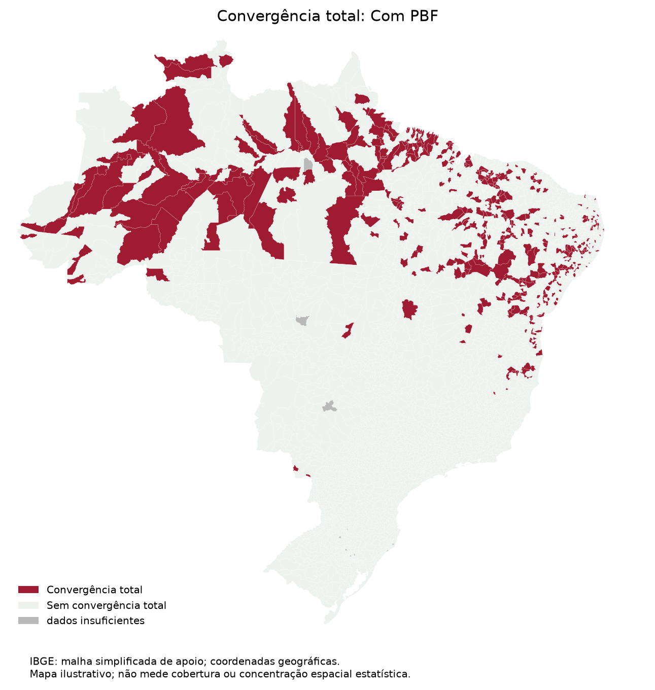
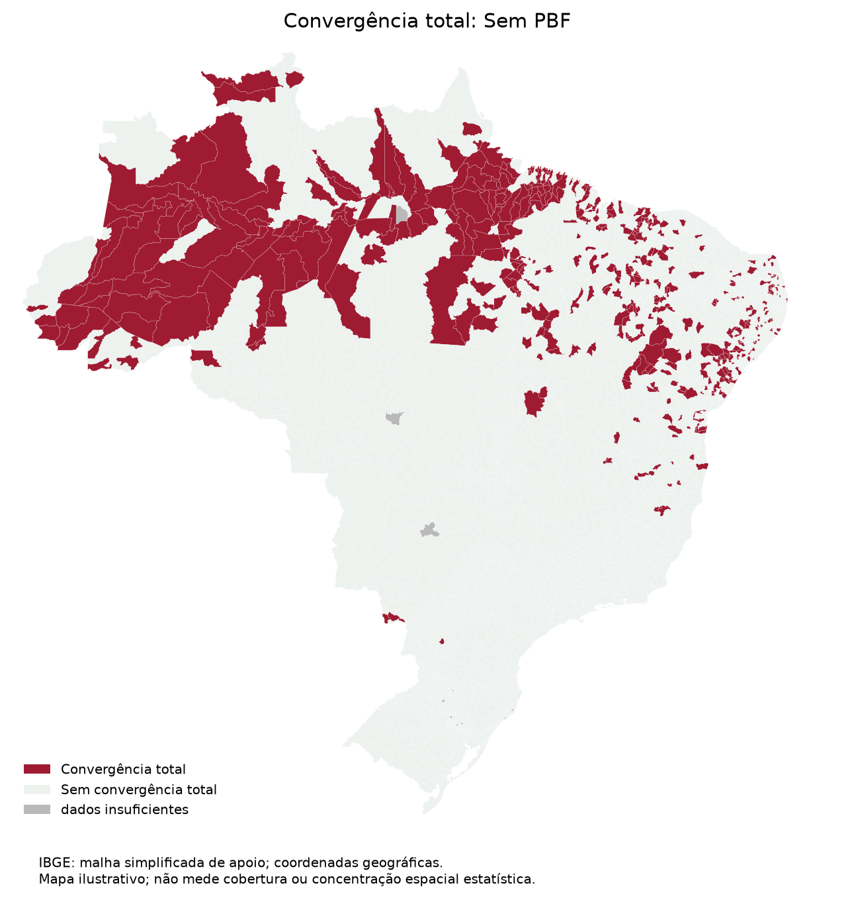

# Risco alimentar e vulnerabilidade social no Brasil

Análise exploratória com objetivo de identificar áreas do Brasil de maior risco alimentar e vulnerabilidade social

## Bases de dados utilizadas

| Entrada                      | Arquivo em`dados/pesquisa/`                                                                         | Referência                            |     Registros | Obtenção                                            |
| ---------------------------- | --------------------------------------------------------------------------------------------------- | ------------------------------------- | ------------: | --------------------------------------------------- |
| IVS e IDHM                   | [atlasivs_municipios_2010.csv](dados/pesquisa/ivs_idhm/atlasivs_municipios_2010.csv)                | 2010                                  |         5.565 | Cozinhas Solidárias; fontes originais Ipea/PNUD/FJP |
| CadInsan                     | [CADINSAN_2025_dados_municipais.csv](dados/pesquisa/cadinsan/CADINSAN_2025_dados_municipais.csv)    | Janeiro/2025                          |         5.570 | Cozinhas Solidárias; relatório original MDS         |
| SISVAN - Altura X Idade      | [CSV de altura](dados/pesquisa/sisvan/sisvan_municipios_altura_por_idade_0_a_menor_5_anos_2025.csv) | 2025; Crianças de 0 a menos de 5 anos |         5.571 | Relatórios públicos do Ministério da Saúde; 27 UFs  |
| SISVAN - Peso X Idade        | [CSV de peso](dados/pesquisa/sisvan/sisvan_municipios_peso_por_idade_0_a_menor_5_anos_2025.csv)     | 2025; Crianças de 0 a menos de 5 anos |         5.571 | Relatórios públicos do Ministério da Saúde; 27 UFs  |
| Malha municipal simplificada | [GeoJSON municipal](dados/pesquisa/apoio/ibge/malha_municipal_simplificada.geojson)                 | Ano não informado pela API            | 5.571 feições | IBGE, API de malhas v4; apoio ilustrativo           |

## Estratégia e indicadores

### Indicadores utilizados

- **IVS:** índice de vulnerabilidade social; valores maiores indicam maior vulnerabilidade social.
- **IDHM:** índice de desenvolvimento humano municipal; valores menores indicam menor desenvolvimento.
- **CadInsan (%):** percentual de famílias do universo analisado do Cadastro Único com risco alimentar estimado, nos cenários considerando a renda do Bolsa Família (PBF) e na simulação sem essa renda.
- **DAI (%):** percentual de crianças avaliadas com altura baixa ou muito baixa para a idade.
- **DPI (%):** percentual de crianças avaliadas com peso baixo ou muito baixo para a idade.

### Dimensões e critérios

| Dimensão    | O que representa                                                                   | Critério adotado                                                    |
| ----------- | ---------------------------------------------------------------------------------- | ------------------------------------------------------------------- |
| Social      | Vulnerabilidade estrutural e baixo desenvolvimento humano                          | IVS ≥0,401**e** IDHM <0,600                                         |
| Alimentar   | Concentração municipal de risco alimentar estimado                                 | 5º quintil nacional próprio, cenários `com_PBF` e `sem_PBF`          |
| Nutricional | Déficits de crescimento em crianças menores de cinco anos acompanhadas pelo SISVAN | DAI ≥6,7%**e** DPI ≥1,8%; mínimo de 20 avaliações em cada relatório |

Os cortes sociais correspondem às faixas alta/muito alta do IVS e baixa/muito
baixa do IDHM.

Os cortes de DAI (6,7%) e DPI (1,8%) e o mínimo de 20 avaliações foram adaptados do [Mapa InSAN 2017–2022, p. 11, tabela 2](https://aplicacoes.mds.gov.br/fomento-questionario/pdf/MapaInSAN_20172022.pdf#page=11). Esses percentuais correspondem às prevalências nacionais estimadas pela Pesquisa Nacional de Demografia e Saúde (PNDS 2006), adotadas como referência pelo Mapa.

O quinto quintil reúne aproximadamente os 20% dos municípios com maior CadInsan.
Seu limite (quantil 0,80, equivalente a P80) é calculado separadamente para cada
cenário, antes dos filtros sociais e nutricionais, com pesos municipais iguais
e empates incluídos. É uma escolha exploratória, não um corte oficial.

### Análise realizada

As bases foram integradas por município para identificar a sobreposição
simultânea das três dimensões em cada cenário. Foram analisados os mapas, a distribuição
territorial e a sensibilidade aos critérios. A análise é
exploratória, sem ranking ou inferência causal. Detalhes metodológicos,
auditorias e limitações estão no [notebook](experimento.ipynb). Os cenários não
são grupos de beneficiários e não beneficiários. Como os cortes são próprios,
a comparação mostra posição relativa, não efeito causal do PBF nem mudança
acima de um patamar percentual comum.

## Resultados

Das **5.571 unidades municipais**, **5.561 são elegíveis** em cada cenário e
**10 têm dados insuficientes**.

| Cenário CadInsan | Corte do 5º quintil | Total selecionado na análise | Selecionadas somente neste cenário | Percentual dos elegíveis |
|---|---:|---:|---:|---:|
| Com PBF | 11,92% | 445 | 199 | 8,00% |
| Sem PBF | 24,76% | 473 | 227 | 8,51% |

**246 unidades municipais são selecionadas em ambas as análises** e já estão
incluídas no total de cada cenário. A coluna “Selecionadas somente neste cenário”
mostra as unidades que não foram selecionadas na outra análise.
O Nordeste tem a maior quantidade
selecionada em ambos; o Norte tem a maior proporção entre seus elegíveis.
Os cortes exibidos são arredondados; a seleção usa os valores sem arredondamento.

Arquivos para consulta e download:

- [Base municipal com os dois cenários](resultados/resultados/execucao_20261020T182348094657Z/base_municipal_final.csv).
- [Convergência com PBF](resultados/resultados/execucao_20261020T182348094657Z/municipios_convergencia_total_com_PBF.csv) e [sem PBF](resultados/resultados/execucao_20261020T182348094657Z/municipios_convergencia_total_sem_PBF.csv).
- [Execução completa em ZIP](resultados/resultados/execucao_20261020T182348094657Z.zip), com comparação, tabelas, mapas, síntese e metadados.

A [execução anterior](resultados/resultados/execucao_20261007T185809662190Z/resumo.md)
preserva o resultado histórico P75/com PBF. Não corresponde à regra atual de quinto quintil.

## Organização do repositório

| Arquivo ou pasta        | Conteúdo                                   |
| ----------------------- | ------------------------------------------ |
| `experimento.ipynb`     | Análise com resultados executados          |
| `dados/pesquisa/`       | Bases utilizadas e documentação            |
| `dados/brutos/`         | XLSX originais do SISVAN                   |
| `metadados/manifestos/` | Registros das coletas                      |
| `resultados/`           | Cópias das entradas, figuras e exportações |
| `scripts/`              | Coletor e cliente SISVAN                   |
| `requirements.txt`      | Dependências para execução local           |

## Referências

- [IVS/IDHM/CadInsan](https://cozsolidarias.triangulos.tech/dados)
- [Relatórios públicos SISVAN](https://sisaps.saude.gov.br/sisvan/relatoriopublico/).
- [IBGE: API de malhas v4](https://servicodados.ibge.gov.br/api/docs/malhas?versao=4).
- [Mapa InSAN 2017–2022, p. 11, tabela 2](https://aplicacoes.mds.gov.br/fomento-questionario/pdf/MapaInSAN_20172022.pdf#page=11): origem dos cortes nutricionais, baseados na PNDS 2006, e do mínimo de acompanhamentos.
